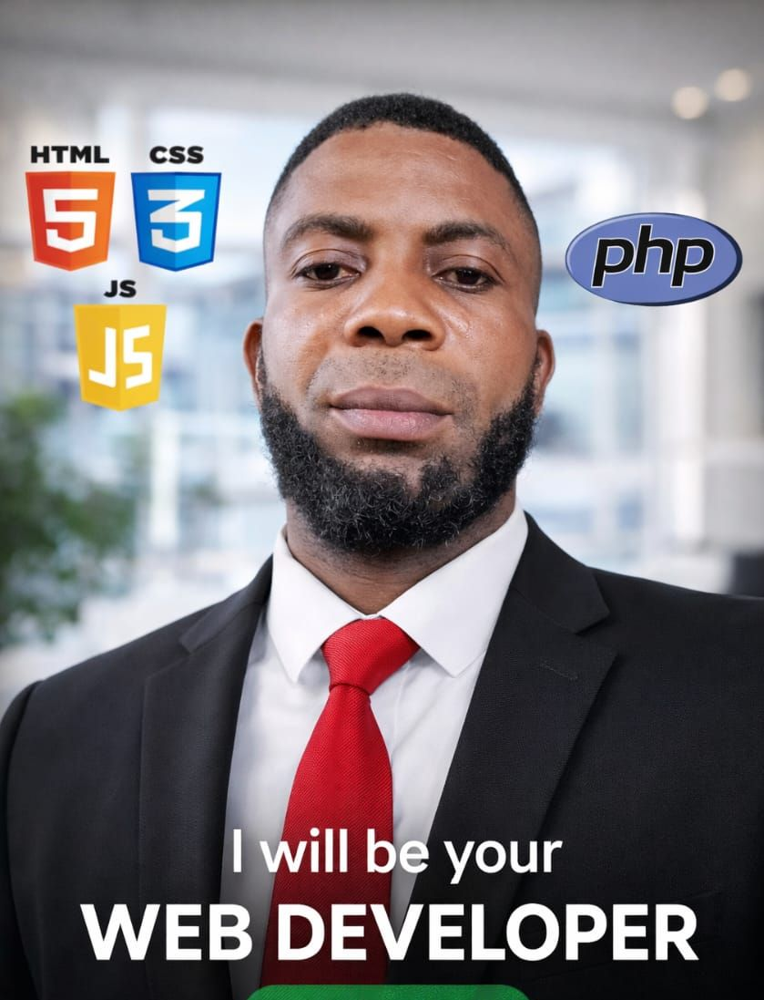
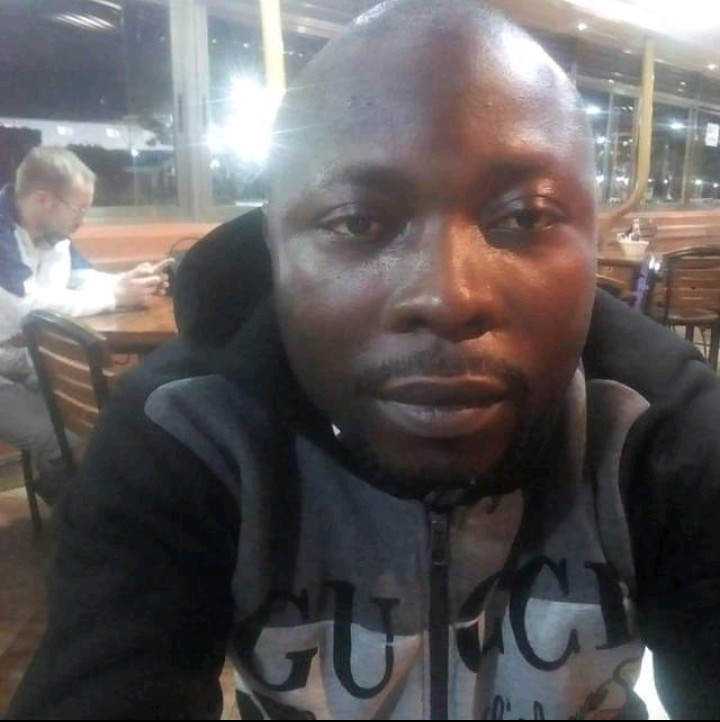

# Pumpswap Team

## Samuel Abiodun Ogunnija — CEO & Founder

Samuel leads Pumpswap's vision, strategy, product direction, and ecosystem growth. A former banking professional turned Web3 founder, he brings business experience and a focus on building accessible staking infrastructure for Solana projects.

- **Role:** CEO & Founder
- **LinkedIn:** [samabiod](https://www.linkedin.com/in/samabiod/)
- **X:** [@pumpsam1](https://x.com/pumpsam1)
- **Telegram:** [let_move](https://t.me/let_move)

## Gate Albert — Chief Technology Officer

Gate is a Solana developer with five years of freelance development experience. He leads Pumpswap's staking platform engineering and smart contract development, working across blockchain infrastructure and web technologies.

- **Role:** CTO
- **X:** [@official_layer](https://x.com/official_layer)
- **Telegram:** [Mpromize](https://t.me/Mpromize)
- **Technical Stack:** Rust, Python, Typescript, JavaScript, Next.js
