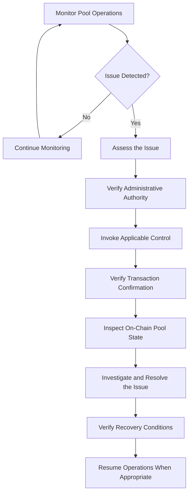

---
title: Administrative Controls
description: Pool administration, pause controls, emergency freeze, and operational safeguards in Pumpswap.
---

# Administrative Controls

Pumpswap is designed with operational safeguards that allow pool administrators to respond to unexpected conditions without compromising user ownership of funds.

All administrative permissions are enforced by the on-chain program. No off-chain service can override them.

## Administrative controls are designed to:

- Restrict privileged actions to the authorized pool authority.
- Provide a mechanism to temporarily pause pool creation and staking.
- Enable rapid response to operational or security incidents.
- Ensure all administrative actions are transparent and verifiable on-chain.

## Pool Pause Controls

The pool authority can pause a pool when intervention is required.

Common reasons include investigation of reward calculations, configuration reviews, or response to unusual activity.

When a pool is paused:
- **Blocked:** New stakes and reward funding.
- **Always Allowed:** Unstaking and reward claims.

This ensures users can always exit, even during an emergency. Pumpswap does not implement a mechanism that locks user funds.

## Emergency Freeze

In addition to standard pause, Pumpswap includes an emergency freeze. This is a per-pool control invoked by the pool authority.

It is scoped to a single pool. There is no protocol-wide freeze that can affect all pools simultaneously.

Recovery requires an explicit `unpause` transaction from the same authority, which is verifiable on-chain.

## White-Label Configuration

Each staking pool can be fully white-labeled by its owner. This allows project teams to present the staking pool as their own product.

Pool owners can configure:

- **Custom Domain Link:** A unique staking URL for their community (e.g., `https://yourproject/liquidpump.app`)

- **Project Logo & Branding:** Upload their logo, brand colors, and banner

- **Pool Identity:** Project name, description, and social links

These settings are managed by the pool authority and are displayed to end-users on the staking interface. White-label settings do not affect on-chain security or user funds and can be updated at any time by the authority.

## Access Control & Security

- Authority is defined by the `pool.authority` key stored in the pool account.
- All privileged instructions require a valid signature from this authority.
- Administrative keys should be held in cold storage or multisig and restricted to trusted operators.
- All admin transactions are public and auditable via Solana explorers.

## Administrative Control Lifecycle

## User Assurance

Pumpswap's administrative design follows a user-funds-safe principle: administrative controls can stop new activity, but they cannot prevent users from unstaking or claiming earned rewards.

