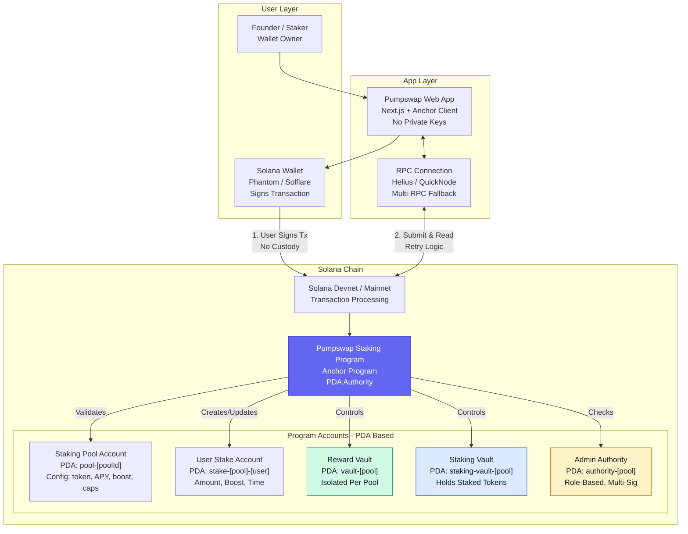

# Staking Architecture

Pumpswap is developing non-custodial, PDA-based staking infrastructure for Solana - built with Anchor, strict account validation, and user-funds-safe design.

**Core Architecture Principle: Non-custodial means users own keys, program owns logic. No admin can steal staked funds. Pause only blocks new staking, never blocks unstake/claim.**

This diagram shows how users, web app, wallets, and on-chain program interact - conceptual overview of production architecture.

## Architecture Overview - REAL ACCOUNTS, REAL VALIDATION

**Key Difference from Basic Diagram:** Old diagram had 3 boxes `Staking Pool Accounts, Token Accounts, Vaults`. New shows REAL architecture: 5 PDA types with seeds, role-based authority, isolated vaults per pool, Anchor program - what auditors expect.

## Main Components

### 1. Web Application

Provides interface founders and participants use for staking operations. Built with http://Next.js + Anchor TypeScript client.

- No private keys stored - ever
- Transaction preparation only - user signs in wallet
- Real-time data via RPC - TVL, APY, vault balance, user position
- Mobile-first, &lt;10 sec staking flow

### 2. Solana Wallet - User Owns Keys

Allows users to review and sign transactions before submission.

- Phantom, Solflare, Backpack, Ledger supported
- User sees exact instruction, accounts, amounts before signing
- Non-custodial: Wallet = owner, program = logic, no middle custody

### 3. RPC Connection - Reliable & Redundant

Connects web app to Solana network - submit transactions and read blockchain data.

- Helius / QuickNode primary + fallback
- Retry logic, blockhash refresh, transaction status verification
- Multi-RPC to avoid single point failure

### 4. Staking Program - Anchor, PDA Authority, Strict Validation

On-chain program processes supported instructions and validates accounts, authorities, and parameters - heart of security.

- **Framework:** Anchor 0.30+ with latest security best practices
- **Authority:** PDA-based - no external authority can drain vaults
- **Validation:** Every instruction validates: signer, PDA seeds, mint, token program, authority, account ownership, amount > 0
- **User-Funds-Safe:** Pause logic: `require!(!paused_for_new_stake)` for stake, but `unstake + claim` always allowed even if paused
- **Instructions:** `initialize_pool, stake, unstake, claim_rewards, fund_rewards, pause_pool, update_config`

### 5. Staking Pools - On-Chain Config, Verifiable

Store configuration and state for individual pools - PDA: `pool-[poolId]`

- Config: staking token mint, reward mint, reward rate, lock period, caps, NFT collection, boost %, claim rules, admin authority
- State: total staked, total rewards paid, pool paused flag (only for new staking)
- Isolated: One pool cannot affect another - no cross-pool contamination

### 6. Token Accounts and Vaults - Isolated, PDA-Controlled

Hold tokens used in staking and reward operations - critical security area.

- **Reward Vault:** PDA `vault-[pool]` - isolated per pool, holds reward tokens, PDA authority = program, only program can transfer out via claim
- **Staking Vault:** PDA `staking-vault-[pool]` - holds staked tokens, PDA authority = program
- **User ATA:** Associated Token Account per user per mint - standard SPL
- **Validation:** Program must validate: mint matches pool config, ATA owner = user or vault PDA, token program = SPL or Token-2022 (with extension checks), amount > 0, authority correct

*Security:* Vaults are PDA-controlled, not admin-controlled. Even if admin key compromised, attacker cannot drain vaults directly - only program logic can release via unstake/claim. Plus pause only blocks new staking.

### Transaction Flow - STEP-BY-STEP, WHAT AUDITORS CHECK

Typical staking transaction - 7 steps, each with validation:

1.  User selects action in web app - e.g., Stake 1000 tokens in Pool #1
2.  App prepares transaction: Gets pool PDA, user stake PDA, vault PDAs, ATAs, builds Anchor instruction with all accounts
3.  Wallet requests authorization - User sees: Program ID, instruction, accounts, amount, displays in Phantom
4.  User signs transaction - Private key never leaves wallet
5.  App submits signed transaction via RPC with retry and blockhash handling
6.  On-chain program validates: signer = user, PDA seeds correct, mint = pool mint, token program valid, amount > 0, pool not paused for new stake (but unstake/claim always passes), user stake PDA ownership
7.  If validation succeeds, Solana processes: Transfer tokens from user ATA to staking vault PDA, create/update user stake account PDA with amount + boost snapshot + timestamp
8.  App displays result - Verifies on-chain, shows updated position, TVL, APY

Exact steps depend on instruction, but validation pattern same for all.

### Security Considerations - HOW WE SECURE EACH LAYER

Program must validate signers, account ownership, PDA seeds, token mints, authorities, token programs, and parameters - every instruction, no exceptions.

**Our Security Stack:**

- **Anchor Best Practices:** `#[account(mut, seeds = [...], bump, has_one = authority)]` etc - strict constraints
- **PDA Authority:** No external key controls vaults - program PDA is authority
- **User-Funds-Safe Pause:** `stake` checks `!paused`, `unstake` and `claim` do NOT check paused - always allowed
- **Token Program Checks:** Validate token program is SPL or Token-2022, check extension compatibility before transfer
- **Arithmetic:** Checked math, no overflow, `checked_add`, `checked_sub`
- **Non-Custodial:** True non-custodial - users own keys, program owns logic, no custodian - but this does NOT eliminate smart-contract risks - bugs can still exist, which is why audit is mandatory

Source-code review, 100+ tests, and independent audit remain critical. Audit scheduled Q1 2027.

### Deployment Status - REAL STATUS

**Current: Live on Solana Devnet - Fully Testable**
**Current: Live on Solana Devnet - Fully Testable**

- Anchor program deployed to Devnet
- All PDAs and vaults working
- SPL + Token-2022 tested with extensions
- User-funds-safe pause verified - unstake/claim works even when paused

**Pending for Mainnet:**
- Independent Tier-1 audit + remediation
- Mainnet deployment with upgrade authority + multi-sig
- Bug bounty program
- Monitoring and incident response setup

Token-2022 compatibility considered verified ONLY for token configurations and instructions successfully tested on Devnet - we publish list of tested extensions.

