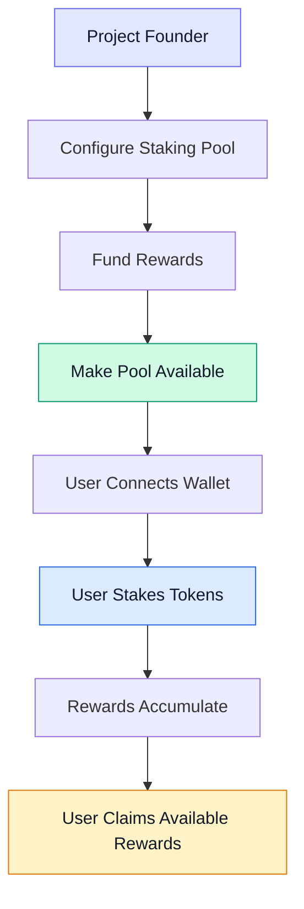

# Staking Platform

**Live on Devnet, No-Code, 5 Minute Launch**

Pumpswap has built a no-code staking platform for Solana project founders who want to launch staking in 5 minutes, not 5 months without building infrastructure, hiring auditors, or spending $100k+ on devs.

**The Problem We Solve:** Building staking from scratch takes 3-6 months, $100k+ audit, and deep Solana expertise. Pumpswap: 5 minutes, no code, audit ready infrastructure.

The platform makes pool configuration, staking operations, reward funding, and administrative management radically accessible - built for founders, not just developers.

## Who Is It For?

**Primary Audience: Solana project founders and teams who want to launch staking this week, not next quarter.**

Perfect for:

- Meme coin founders wanting to add utility and reduce sell pressure - stake to earn
- NFT projects wanting to reward holders - NFT boost = 3x retention
- DeFi projects needing staking for tokenomics - flexible APY, lockups, vesting
- Launchpads wanting white-label staking for all launches - multiple pools, isolated vaults
- Any Solana team that wants staking without building it - 5-minute setup

If you can fill a form, you can launch a staking pool on Pumpswap.

## Core Capabilities

Our platform is live on Devnet, entering audit - not just an idea:

- **Configurable Staking Pools in 5 Minutes:** No-code dashboard - token, APY, lock period, caps, NFT boost, claim rules - all in UI
- **Staking & Unstaking - 1-Click UX:** User connects wallet, stakes, unstakes, claims - &lt;10 second transactions, mobile-friendly
- **Reward Funding & Vault Management:** Isolated vaults per pool, real-time dashboard - balance, burn rate, runway, low-balance alerts - fund 30-90 days in one tx
- **Multiple Independent Pools:** Launch unlimited pools per project - different tokens, different APYs, different rules - isolated risk, no cross-pool contamination
- **NFT-Based Staking Boosts - 10% to 200%:** Configure collection + boost %, users hold NFT in wallet = auto-boost, sell = lose boost - 3x retention, verified on-chain
- **Administrative Pause - User-Funds-Safe:** Emergency pause only blocks NEW staking - existing stakers can ALWAYS unstake & claim rewards - funds never locked, trust maximized
- **Full Token Compatibility - SPL + Token-2022:** First no-code platform supporting both SPL Token Program AND Token-2022 with all major extensions - transfer hooks, interest-bearing, confidential - verified on Devnet
- **Enterprise Controls:** Role-based access, multi-sig ready, audit-ready code, 100+ test cases, public GitHub

**This is not "development includes" - This is live, tested, and working on Devnet today.**

## Current Status

**Live on Solana Devnet - You can test today:**

- ✅ Pool creation & configuration - 5-minute flow verified
- ✅ Staking & unstaking - PDA validation, authority checks
- ✅ Reward funding & vault management - isolated vaults
- ✅ Multiple pools - independent, no cross-contamination
- ✅ NFT boosts - collection verification, anti-spoof, boost math
- ✅ Admin controls - pause with user-funds-safe design - unstake/claim always works
- ✅ SPL + Token-2022 compatibility - all major extensions tested

**Next:**
- 🔄 Q1 2027: Independent Tier-1 Audit (OtterSec/Halborn/CertiK level) - Scheduled
- 🔜 Q1 2027: Mainnet launch after audit fixes + re-audit
- 🔜 Public audit report + bug bounty

**Test it:** http://doc.pumpswap.biz/app (Devnet) | GitHub: http://github.com/pumpswapeco/pumpswap

## How Pumpswap Staking Works - FROM FOUNDER TO REWARDS IN 8 STEPS

The diagram below illustrates the intended staking workflow, from pool configuration to reward claiming.

