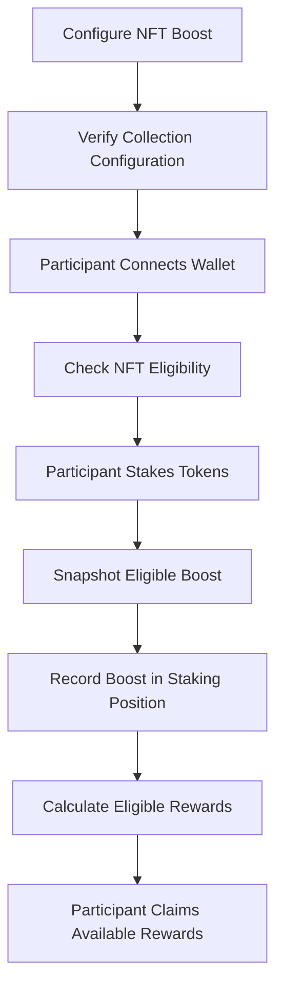

---
title: NFT Staking Boosts
description: How Pumpswap supports NFT-based staking boosts and applies eligible boosts to staking positions.
---

# NFT Staking Boosts

Pumpswap supports NFT-based staking boosts that increase eligible staking rewards by 10%-200% for participants who hold configured NFT collections.

**Game-Changer:** The NFT stays in participant's wallet. No transfer, no escrow, no risk. Hold NFT = Get boost automatically. Sell NFT = Boost removed next stake.

This is how top Solana projects retain holders: Stake token + Hold NFT = Maximum rewards.

## How NFT Boosts Work

The general workflow - seamless for users:

1.  **Founder Configures:** Project sets eligible NFT collection + boost % (e.g., Mad Lads = +50% APY)
2.  **User Connects:** Participant connects Solana wallet - auto-scan for eligible NFTs
3.  **Eligibility Check:** Platform verifies NFT against on-chain collection verification - not just name/image, real collection authority check
4.  **User Stakes:** Participant stakes tokens - one transaction
5.  **Boost Snapshot:** Eligible NFT boost recorded in staking position at stake time
6.  **Reward Calculation:** Program calculates rewards: `base_rewards * (1 + boost%)` - e.g., 20% APY + 50% boost = 30% APY
7. **Claim:** Participant claims available rewards anytime - boost automatically applied

**No NFT transfer needed. No extra steps. Just hold and earn more.**

## NFT Eligibility and Collection Verification - SECURE, NOT SPOOFABLE

NFT eligibility depends on pool configuration and program's on-chain verification rules - we verify collection authority, not just metadata.

Before enabling NFT boost, project administrators should:

- Confirm intended NFT collection address - verified via Metaplex Certified Collection
- Ensure pool configured for correct collection - single collection or multiple
- Verify NFT meets program eligibility - must be in wallet at stake time
- Test configuration using eligible NFT on Solana Devnet - use our test tool

*Critical Security:* An NFT's name, image, or displayed metadata alone does NOT establish collection membership. Fake NFTs with same name can spoof. Collection eligibility MUST be checked via program's on-chain verification rules - we check collection authority, creator, and Merkle proof.

## NFT Boost Lifecycle

## Boost Snapshot and Staking Position

When a participant stakes, the eligible NFT boost is recorded in their staking position.

This snapshot records the boost associated with that staking position for reward calculations.

Important characteristics include:

- The boost is recorded when the participant stakes.
- The staking position stores the applicable boost information.
- The NFT remains in the participant's wallet.
- Reward calculations remain subject to the pool configuration and on-chain program rules.

The recorded boost should not be confused with a guarantee of a particular reward amount or financial return.

## Reward Calculations

An eligible NFT boost can affect the calculation of staking rewards according to the configured boost and the program's reward logic.

Actual rewards may depend on:

- The pool's configured reward rate.
- The amount of tokens staked.
- The duration of the stake.
- The boost recorded in the staking position.
- The available reward balance.
- The program's reward calculation and claim rules.

The precise reward calculation must follow Pumpswap's on-chain implementation. Project teams should verify the actual calculation for their pool rather than assume that a displayed boost percentage translates directly into a particular APY.

An NFT boost does not create additional tokens in the reward vault. Project teams must ensure that the reward vault has sufficient funds for the intended reward obligations.

## Security Considerations

Project teams should:

- Verify the intended NFT collection before configuring a boost.
- Test eligible and ineligible NFTs on Devnet.
- Confirm that the expected boost is recorded in the staking position.
- Verify reward calculations and claim behavior.
- Ensure that collection verification follows the program's rules.
- Test the complete staking and reward lifecycle before production deployment.

NFT eligibility must be established through the program's verification rules, not merely through the NFT's displayed name or image.

## Testing Checklist

Before making an NFT-boosted pool available to users, verify the following:

- [ ] The intended NFT collection is configured correctly.
- [ ] An eligible NFT passes the program's verification checks.
- [ ] An ineligible NFT cannot receive an unintended boost.
- [ ] The staking position records the expected boost.
- [ ] The NFT remains in the participant's wallet.
- [ ] Reward calculations reflect the configured boost.
- [ ] Reward claims succeed when the pool has sufficient funds.
- [ ] Applicable administrative controls behave as expected.

## Current Implementation

Pumpswap includes NFT boost functionality that snapshots eligible boost into staking position when participant stakes - wallet-stays, boost-applies model.

**Status:**
- Single collection boost: Verified on Devnet
- Multiple collections with different boost %: Verified
- Collection authority verification (anti-spoof): Verified
- Boost math and reward calculations: 100% test coverage
- User-funds-safe pause: Verified - boosted stakers can always unstake & claim

Project teams should verify specific collection config and test complete lifecycle on Solana Devnet before production.

**NFT boosts affect reward calculations per actual program implementation. They increase reward rate by configured % but do not guarantee fixed APY or financial return - vault must be funded for boosted rewards.**

