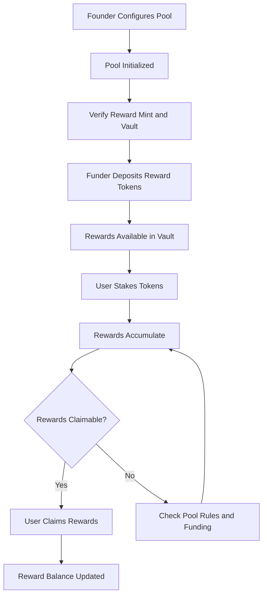

# Pools and Rewards

Pumpswap is designed to let project founders configure staking pools in under 5 minutes and manage reward funding with full transparency and user-funds-safe controls.

**Core Principle: Reward funding is isolated per pool. Users can always unstake & claim, even if pool is paused - only new staking is restricted.**

## Pool Configuration

A staking pool defines the complete rules for staking. Founder configures via dashboard:

**Key Parameters:**

- **Staking Token:** Any SPL or Token-2022 token - your project token
- **Reward Token:** Same or different token - e.g., stake $MYTOKEN, earn $PLH or $SOL
- **Reward Rate:** Flexible APY configuration - fixed, dynamic, or tiered
- **Lock Period:** Optional - no lock, fixed lock, or flexible with early unstake penalty
- **Pool Caps:** Max stake per wallet, total pool cap, min stake
- **NFT Boost:** Enable NFT collection + boost percentage - e.g., 25% extra APY for holders
- **Claim Rules:** Instant claim, periodic claim, or vesting
- **Emergency Controls:** Role-based admin, emergency pause (only blocks new staking, not unstaking/claims)

All parameters are stored on-chain and verifiable. No hidden rules.

## Reward Funding - TRANSPARENT & ISOLATED

Reward funding supplies tokens to pool's designated isolated reward vault - separate vault per pool, no cross-pool risk.

**Funding Process:**

1. Founder creates pool → Isolated reward vault PDA created
2. Verify pool address, reward mint, token program, funding amount
3. Funder deposits reward tokens into vault - on-chain verifiable
4. Dashboard shows real-time: vault balance, burn rate, days of rewards remaining, low-balance alerts

**Best Practice:** Fund vault with 30-90 days of rewards initially. Our dashboard calculates exact funding needed for target APY based on projected TVL.

## Reward Calculations

Reward Calculations - ON-CHAIN, VERIFIABLE

Displayed reward estimates depend on pool configuration and on-chain calculation rules.

**How It Works:**

- Rewards accumulate per second based on: `user_stake_share _ reward_rate _ time`
- Reward rate = configurable APY / (total staked)
- NFT boost multiplies user reward rate if eligible NFT held
- All calculations on-chain, no off-chain oracle, fully auditable

*Users should review actual pool configuration* - our UI shows: pool APY, your share, estimated daily rewards, vault runway - before staking.

**APY Display:** Displayed APY is real-time estimate based on current total staked. Not guaranteed return - changes as more users stake.

## Important Limitations

- Rewards depend on pool config and available funding - if vault empty, rewards pause, staking continues
- Displayed APY is estimate, not guaranteed - varies with TVL
- Transaction fees (Solana ∼0.000005 SOL) and Token-2022 transfer hooks may affect outcomes
- Pool rules and claim restrictions documented on-chain per pool - read before staking
- **Pause Safety:** If pool paused for emergency, new staking blocked, but existing stakers can ALWAYS unstake and claim rewards - user exit rights prioritized

## Development Status

Pool and reward functionality is live on Solana Devnet with 100+ test cases passing.

- SPL Token Program: Verified
- Token-2022: Verified including major extensions
- NFT Boost: Verified
- Emergency Pause with user-funds-safe design: Verified - unstake/claim always works

Production behavior validated on Devnet. Mainnet deployment pending Q1 2027 audit.

## Pool and Reward Lifecycle - USER-FUNDS-SAFE FLOW

The diagram illustrates how a staking pool is configured, funded, used by stakers, and monitored for reward availability.

**Key Difference from Other Platforms:** Most platforms freeze everything on pause - users trapped. Pumpswap: Pause only blocks NEW staking. Existing stakers ALWAYS can unstake + claim. This is our user-funds-safe guarantee.

The actual sequence depends on deployed program and pool config, but this lifecycle applies to all pools - user exit rights always protected.

